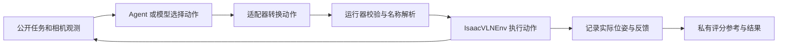

# 运动策略：现有实现与 Stretch 预期实现

代码核查日期：2026-11-26。本文说明当前行为及后续设计，**预期部分尚未实现，不改变现有执行和评分规则**。
默认及官方本体为 Stretch3 `stretch3_kinematic_circle_v1`，圆柱保留为非官方历史基线。型号和尺寸见 [ROBOTS](ROBOTS.md)，正式规则仍以 [RULES](RULES.md) 为准。

## 1. 更换本体是否影响运动策略

**会影响策略执行效果，但当前不会自动切换控制方法。**
现在选择 Stretch，仍由同一套高层动作直接更新位置和朝向；身体变宽后可能被挡住，相机视角改变后模型也可能做出不同决定。
运行器没有因此换成差速底盘控制器，也没有自动训练或加载专门的 Stretch 策略。

| 改动 | 对动作执行的影响 | 对 Agent 的影响 |
|---|---|---|
| 仅换外观 | 基础位移公式不变，画面可能变化 | 输入变化，不能保证决策完全相同 |
| 修改尺寸/碰撞轮廓 | 同一动作可能从可通过变为被挡住，或反过来 | 需要重新选择路线、接近位置及转弯时机 |
| 修改相机高度/安装位置 | 移动距离不随相机高度缩放，观察内容改变 | 需要重新验证视觉策略；不意味着必然要重新训练 |
| 加入真实 Stretch 底盘约束 | 不能直接横移，移动需要可执行的前进/后退/转向过程 | 需要适配动作接口，或增加公开且统一的局部控制层 |
| 加入机械臂抓取 | 不再能在身体周围任意“拿起”，必须对准并伸到物体 | 需要选择抓取站位、手臂动作、搬运姿态和放置位置 |

例子：Agent 想向侧面移动 0.25 m。当前环境直接横移；真实 Stretch 必须转向后移动，必要时再恢复朝向。
这个过程占用更多时间和空间，窄处甚至无法完成。因此更换控制规则后，动作、碰撞和评分必须一起核验。

## 2. 当前实现

### 2.1 谁决定动作，谁执行动作

Agent 决定往哪里走；环境负责执行和碰撞。评分器计算的最短路只用于评分，**不是自动替 Agent 导航的路线**，也不会发送给 Agent。

SimpleNav 的具体适配逻辑在 [agents/simplenav.py](../roboodyssey/agents/simplenav.py)：

- 从模型返回的四元组序列中只取第一组 `(dx, dy, dz, dyaw)`；不执行整串轨迹，`dz` 不用于移动。
- 按当前阈值规则选一个动作：符合优先条件则转向，否则优先前后移动，再左右移动，最后为 `no_op`。
  这是简化映射，不是底盘轨迹规划，也不是将模型同时输出的平移和旋转一起执行。
- 连续收到碰撞反馈达到阈值时可请求 reset，默认阈值为 5，0 表示关闭，记录来源为 `adapter_recovery`。
- 当前适配器对操作或问答任务返回 unsupported；换成带夹爪的 Stretch 也不会让 SimpleNav 自动具备抓取能力。

其他 Agent 可使用自己的决策方法。当前运行器按任务限制部分动作，没有按机器人型号生成底盘能力约束；
`capabilities` 主要描述任务需要的能力，不是已经实现的机器人驱动能力。

### 2.2 平移、转向和观察

实现位于 [scenes/isaac_env.py](../roboodyssey/scenes/isaac_env.py) 的 `EnvConfig`、`step`、`_author_camera_pose`。

| 项目 | 当前执行方式 |
|---|---|
| 平移 | 支持前进、后退、左移、右移；默认 0.25 m，可传 `distance`，单次最多 10 m |
| 转向 | 默认 15°，可传 `angle_degrees`，单次限幅到 ±720°；直接修改水平朝向 |
| 动作过程 | 平移先做沿途几何采样，随后直接写入最终位置；没有按轮速连续驶过采样点 |
| 抬头低头 | 默认 15°，俯仰限制为 ±80°；改变虚拟相机，不驱动真实头部关节 |
| 速度/加速度 | 未按机器人速度、加速度、轮胎接触或质量惯量计算 |
| 时间 | `step_seconds=1/30` 没有用于底盘运动积分，不能由 0.25 m/步推算实际速度；2 FPS 是观测发送频率 |

前进方向随当前朝向变化。需要纠正的一个现有约定是：代码将 `(-sin(yaw), cos(yaw))` 命名为 `right`，
并用于 `move_right`；在本文采用的 X 向前、Y 向左、Z 向上的坐标中，它实际上指向左侧。
例如朝向为零时，当前 `move_right` 增加 Y，`move_left` 减少 Y。手持物体的横向偏移也使用同一向量。
这与名称存在冲突；后续应统一环境、模型输出坐标和日志定义，并版本化处理，不能默默翻转旧结果的含义。

### 2.3 碰撞、过门与起点

当前使用二维占据网格和一个圆形范围。`_walkable` 判断身体圆与占据单元是否相交，
优先使用未按半径扩大的 `static_base_occupancy`；不是由机器人 USD 网格与 PhysX 接触决定能否移动。

| 项目 | 当前行为和边界 |
|---|---|
| 平移沿途检查 | `_free_distance` 按不大于 0.05 m、且通常不大于半格的间隔采样；底限为 0.001 m |
| 被挡住时 | 停在已检查的安全距离内，并按配置预留最多 0.1 m 的退让距离；反馈 blocked、collision 和实际位移 |
| 转向碰撞 | 没有单独检查转身扫过的空间；圆形代理不区分朝向 |
| 过门 | 按网格中门框、门扇等占据判断；有开关门辅助逻辑，但不是通过手臂拉动门 |
| 场景门状态 | 发布场景的冻结开门策略决定初始几何，不能把加载时的开门设置称为 Agent 学会开门 |
| 身体高度 | 未参与顶部/桌底等三维碰撞判断；部分障碍生成逻辑仍含固定 1.5 m 高度筛选 |
| 冻结起点 | 新机器人在工厂创建环境后用当前圆形半径检查起点，放不下就报错，不改冻结起点 |
| 当前任务可达性 | 尚无完整的按本体检查所有起点、通道和目标区域的预检；CPU dry-run 不证明几何可达 |

Stretch 默认碰撞半径为 **0.29 m**：实际可见网格相对根坐标最大 XY 距离 0.276497 m，
加 0.01 m 余量后向上取整至厘米。Builder 场景派生、运行和评分参考统一此半径。
虚拟相机高度仍为 **1.50 m**。模型宽 0.3701 m、高 1.4098 m；0.1850 m 半宽不能替代偏心根坐标的包围圆。
该版本是固定姿态的保守二维圆，尚未实现下文建议的带朝向轮廓。

### 2.4 身体、相机和持物

[robot_body.py](../roboodyssey/scenes/robot_body.py) 中的静态 USD 随位置和水平朝向移动。
身体高度由模型几何决定；根节点 Z 由当前相机 Z 减相机安装高度、再加落地偏移得到。
相机俯仰不会带动整个身体倾斜，外观也不会驱动轮子、升降、伸缩臂或夹爪。

因此身体高约 1.41 m，**不表示相机应直接设成 1.41 m**。当前虚拟相机为 1.50 m；
未来真实相机的位置需要从所选相机安装变换和关节状态计算。

| 操作 | 当前实现 |
|---|---|
| pick | 目标须可抓取且未持有其他物体；只检查物体原点与身体位置的水平距离 ≤1.5 m；不检查末端能否伸到、夹爪开口或负载 |
| 持物 | 物体被设为运动学对象，固定跟随身体前方 0.75 m、代码横向向量方向 0.35 m、相机下方 0.22 m；不连接真实夹爪 |
| 持物碰撞 | 额外按物体尺寸计算范围检查关闭门；未完整检查物体相对身体的偏移、碰墙/家具及旋转扫掠 |
| place | 把物体移到身体前方 0.8 m 的地面高度并释放；无机械臂下降和松夹过程，合法交付仍由实际状态与 GT 检查 |
| reset | 直接回到保存的起始/安全位姿，不恢复世界、任务预算和记忆；持物状态保留，物体随位姿更新 |

当前 Stretch URDF 的两个夹指关节限位、速度和驱动力均为零，需先补齐适用模型/驱动，才能接入夹爪开合。
不能仅凭“模型有夹爪”声称当前实现支持真实抓取。

### 2.5 路径与搬运评分

当前路径参考来自 [evaluation/navigation.py](../roboodyssey/evaluation/navigation.py)：
在带半径的网格上用八邻域最短路计算距离，禁止斜穿墙角，按序连接多个目标的达标区域。
运行与参考使用同一半径和地图状态，但碰撞判定在两处分别实现，参考又有网格离散近似，不能保证与连续运动完全相同。
导航状态没有把机器人朝向作为搜索维度。

导航成本计算实际 XY 路程及 reset 等效路程；转向、等待和原地碰撞不额外增加路径成本，耗时和步数另列。
搬运参考在 [evaluation/transfer.py](../roboodyssey/evaluation/transfer.py) 中使用同样的通行近似，
加上当前 1.5 m 抓取范围、0.8 m 放置偏移和抓放尝试成本；放置会采样朝向，但底盘路径搜索仍不考虑朝向。
因此它衡量的是当前逻辑抓放工作量，不是真实机械臂完成任务所需的时间或能量。

当前动作日志主要保存每次动作前后位姿；直线平移可据此算长度，未来若执行转向＋移动或曲线路径，
仅用两个端点就会漏计中间路程。具体计分和不可达参考的处理仍遵循 [RULES](RULES.md#scoring)。

## 3. 预期实现

以下是建议实施目标，尚无对应新 CLI 模式。先完成能正确通行的 Stretch 控制，再接关节与动力学。

### 3.1 用身体轮廓定义空间

正向直行过门使用身体宽度，安全余量单独保存。当前 Stretch 对应的等效半宽为 0.1850 m，
**不能直接把全方向圆形碰撞参数改成 0.1850 m 就认为完成了修正**。
身体相对根坐标前后/左右不对称，预期碰撞数据应保存这些偏移、轮廓和姿态版本。

| 字段/能力 | 预期用途 |
|---|---|
| 当前姿态的俯视轮廓与根坐标偏移 | 平移、斜向进门和转弯统一使用真实占地；第一阶段可用经过核验的矩形或凸多边形 |
| 身体高度与相机安装位置 | 分开保存；后续高度分层/三维检查使用身体几何，相机只负责观察 |
| 安全余量、地图精度与接触边界约定 | 明确记录并只应用一次，避免地图与本体重复加宽 |
| 持物和机械臂姿态 | 轮廓随收臂、伸臂和携物变化；固定外观轮廓仅用于固定姿态模式 |

检查整个动作过程：平移检查沿途轮廓，转向检查角度变化期间的轮廓，不能只检查起终点。
采用连续几何检查，或根据地图精度及轮廓最远点的移动量确定保守采样和余量；近门框接触要有一致判定。
运行器、起点检查和评分参考共用同一套碰撞查询，评分依然可以采用明确记录精度的离散搜索。
不要通过缩小身体、扩大门洞或移动冻结起点解决不可达问题。

### 3.2 让 Stretch 按底盘能力移动

Stretch 是差速底盘。第一阶段可在不模拟轮胎动力学的情况下，提供受约束的前进、后退、原地转向，
再按需要增加弧线行驶；均按过程更新状态并检查碰撞。线速度、角速度、加速度和时间步长应使用核实的控制配置，
当前未核实的硬件最大速度不填推测值。

动作分工建议：

- 原圆柱/旧模式继续保留原动作含义，单独标记，保证历史结果可复核。
- 新 Stretch 模式在公开能力和 `allowed_actions` 中禁用直接横移；运行器与环境都校验，不能只依靠提示词。
- SimpleNav 等输出侧向目标的 Agent，需要明确版本的适配层，转为“转向—移动—转回”或局部可执行轨迹。
  每一段都检查并记录，途中被挡住就反馈实际进度，不能作为一次免费横移或未计费的额外动作。
- 通用协议中的距离/角度需要校验有限数值、符号和范围；统一模型输出的左右/角度约定，加入朝向为零时的方向核验。

局部控制层只落实 Agent 指定的动作/局部目标。若加入局部规划器，其输入应遵守同一公开观测规则，
不得使用评分器私有地图或隐藏目标替 Agent 规划；环境私有碰撞检查只负责判断执行是否合法。
能力配置应在运行前固定，对所有被比较的 Agent 一致。

### 3.3 让导航站位服务于抓取

预期流程为：选择可抓取站位 → 移动并调整朝向 → 升降/伸臂/调手腕 → 闭合夹爪或执行受限辅助抓取 →
验证持有 → 收到可搬运姿态 → 导航 → 到达可放置姿态 → 释放并验证。
每个阶段失败都返回实际状态，不跳过必要动作。

建议先接“末端可达＋关节限位＋机械臂/物体碰撞”约束下的辅助抓取，并显式标记模式；
后续再验证接触、摩擦和夹持稳定性。修正夹指模型需要官方依据，不随意放开全部限位。
不能把 0.52 m 伸缩行程直接当成身体中心周围 0.52 m 的抓取圆，也不能把额定 2 kg（含夹爪）当成额外物体载荷。

持物应绑定真实末端或明确的辅助附着点，碰撞范围包含身体、手臂及所持物体。
需要从抓取接触状态过渡到搬运状态，不能将对象立即扩成身体中心的大圆而使起始状态不可运动。
目标站位还须满足相机视野、机械臂高度和放置条件；仅“走到目标附近”不再足够。

reset 保留为明确的评测恢复工具，不称作机器人恢复技能。新模式在恢复前检查当前世界与持物情况下的安全性，
保存实际 reset 路径等效成本；真实恢复能力需单独评估后退、转向和重规划。

### 3.4 评分随动作能力同步升级

预期底盘参考状态至少包含位置和朝向，搜索边必须是控制器能执行、且通过同一碰撞检查的移动/转向。
可采用带朝向的离散状态图；手臂进入控制后，还需区分收臂、抓取、携物与放置状态。
不能让评分参考自由横移、穿过不可转身的窄处，或继续在 1.5 m 内任意抓物。

建议分开报告两个指标，避免改变单位后仍沿用旧“路径效率”名称：

| 指标 | 预期比较方式 |
|---|---|
| 可执行路径效率 | 当前本体约束下的最短可行路程与实际分段路程比较；原地转向不增加米数，但参与可达性判断 |
| 动作/时间成本效率 | 与本体控制限速、转向和抓放一致的参考成本比较；独立定义单位与版本，不任意混合米、角度和秒 |

区分仿真执行时间、Agent 推理耗时和进程实际耗时；人工 `step_delay` 不能当作底盘速度。
记录分段位置、朝向、关节状态、碰撞、执行时长和实际长度，避免只取首尾直线距离。
参考与实际采用相同的时间/动作计量规则，reset 仍单列，不隐藏其帮助。

新模式需要新评测身份和参考版本，至少保存本体/轮廓/姿态哈希、控制约束、相机配置、余量、抓取模式、
地图及朝向离散精度；旧圆柱与旧逻辑抓放结果按原版本复核，不批量重算成新分数。
起点无效或该本体先天不可达的任务应报告本体与数据兼容性问题，不能伪装成 Agent 普通失败，也不能悄悄从分母删除。
任务集筛选、适用范围与分母如需改变，须作为明确的新评测设置发布。

## 4. 分阶段实施与验收

| 阶段 | 交付目标 | 核心验收 |
|---|---|---|
| A：轮廓一致性 | 在保留旧模式的前提下，新模式共用轮廓碰撞、起点/目标通行检查及带朝向参考 | 窄门、斜向、靠墙转弯、根坐标偏移和评分参考一致；地图只加一次余量 |
| B：底盘约束 | Stretch 禁止直接横移，执行有过程的前进/后退/转向；适配 Agent 与日志/参考成本 | 方向正确、横移不会静默执行、组合动作过程被计费、弯曲轨迹长度不按端点低估 |
| C：操作接入 | 修正夹爪模型，接入末端可达检查和显式抓取模式，正确搬运/放下 | 超出工作空间不能抓、伸臂/持物不能穿墙、失败保持真实状态、合法释放才能交付 |
| D：物理与感知 | 验证轮速、加速度、接触抓取和真实头/腕相机；增加三维空间检查 | 对照控制配置测实际运动与持物稳定性，校验相机标定和不同高度障碍 |

A 阶段若暂保留高层横移，须明确标为高层模式；只有完成 B 后才能宣称符合 Stretch 底盘运动约束。
现有 CPU 测试与 Isaac 冒烟检查验证的是旧圆形模型和静态身体跟随，不能作为上述新功能已经通过的证据。

建议至少增加以下场景验证：

- 长 0.8 m、宽 0.4 m 的合成身体正向通过有足够余量的 0.6 m 门；横过来不能通过。转身还需单独有空间。
- 当前 Stretch 的 0.3701 m 宽轮廓正向通行使用半宽约 0.1850 m；校验根坐标左右范围不同，不能换成对称小圆。
- 移动起终点均无碰撞但中间有薄墙时，被挡住；转向起终点均合法但途中擦墙时，也被挡住。
- 伸臂或持物后的窄门/家具碰撞，与空手收臂情况不同；运行和参考给出相同可通行判断。
- 相机高度改变只影响观察，不改变身体宽高；身体高度检查开启后，高低横梁得到不同通行结果。
- 地图变化后旧 reset 点不安全时明确反馈；无效起点和不可达任务保留原因，不自动搬移或排除。
- 旧圆柱和历史评分保持原行为；不同控制版本的结果分开展示，禁止混算。

## 5. 实现定位与后续修改范围

| 文件 | 当前职责 / 后续要点 |
|---|---|
| [agents/simplenav.py](../roboodyssey/agents/simplenav.py) | 模型输出简化为动作、碰撞恢复；后续适配差速动作和公开能力，不能因换本体声称模型支持抓取 |
| [agents/protocol.py](../roboodyssey/agents/protocol.py) | 动作类型与响应校验；后续完善数值约束、能力与坐标约定，必要时同步协议版本和示例 Agent |
| [runtime/request_runner.py](../roboodyssey/runtime/request_runner.py) | 公开动作限制、名称解析、执行与日志；后续按模式生成动作集、校验并记录多段执行证据 |
| [scenes/isaac_env.py](../roboodyssey/scenes/isaac_env.py) | 当前位姿更新、圆形碰撞、抓放/reset；后续接共享碰撞与底盘/机械臂控制 |
| [scenes/robot_body.py](../roboodyssey/scenes/robot_body.py) | 本体解析、资产身份、静态身体同步；后续区分静态与关节模式及其碰撞/控制配置 |
| [contracts/raster.py](../roboodyssey/contracts/raster.py) | 障碍物网格；后续区分基础几何与本体占地，核查高度过滤和重复膨胀 |
| [evaluation/navigation.py](../roboodyssey/evaluation/navigation.py) | 当前位置网格最短路；后续增加带朝向的可执行参考，与运行共用碰撞查询 |
| [evaluation/transfer.py](../roboodyssey/evaluation/transfer.py) | 逻辑抓放成本；后续匹配真实站位、末端可达、携物轮廓与操作规则 |
| [evaluation/task_metrics.py](../roboodyssey/evaluation/task_metrics.py) 及报告/复算入口 | 后续处理轨迹分段、版本化参考及指标；保持历史复算入口 |
| [run.py](../roboodyssey/run.py)、[launch/simplenav.py](../roboodyssey/launch/simplenav.py) | 模式选择、配置传递、起点检查和身份记录；新模式不自动沿用原 official 资格 |
| robot 资源目录 | `profiles/stretch3.json`、轮廓/姿态、URDF/关节 USD 与控制配置；保持哈希和许可可追溯 |

共享碰撞/运动模块的具体文件名在实施时确定，本次不新增这些运行模块。
RoboOdyssey 的场景工厂由 `scenes/isaac_backend.py` 维护，CLI 与进程内策略共用同一初始化、起点检查和清理流程。
